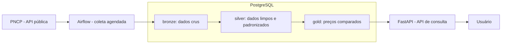

# Arquitetura — SaudeVigia

Plataforma que monitora compras públicas de saúde (medicamentos, equipamentos e materiais médicos): coleta os registros do PNCP, padroniza os produtos, compara preços entre órgãos e aponta valores fora do padrão.

## Fluxo dos dados



## Componentes

| Componente | Papel |
|---|---|
| **Airflow** | Agenda e orquestra a coleta e as transformações. A lógica fica em funções Python na pasta `pipelines/`, testáveis sem o Airflow. |
| **PostgreSQL** | Guarda os dados em camadas: bronze (resposta original do PNCP), silver (itens limpos e padronizados) e gold (preços agregados e comparações). |
| **FastAPI** | API de leitura sobre a camada gold. Começa com a rota `/health`. |
| **Alembic** | Versiona a estrutura do banco desde a primeira tabela. |
| **Docker Compose** | Sobe API, PostgreSQL e Airflow no ambiente local com um comando. |
| **GitHub Actions** | CI em todo Pull Request: Ruff, pytest, build da imagem Docker e validação das DAGs. CD: deploy da API a cada merge na main. |
| **Render + Neon** | Hospedagem da API e do banco em produção. |

## Estrutura de pastas (planejada)

```
SaudeVigia/
├── backend/                  # tudo que é Python
│   ├── app/                  # API FastAPI
│   │   ├── core/             #   configurações (.env)
│   │   ├── db/               #   conexão com o banco
│   │   ├── models/           #   tabelas (SQLAlchemy)
│   │   ├── schemas/          #   entrada e saída da API (Pydantic)
│   │   └── routers/          #   rotas
│   ├── dados/                # coleta e transformação (PNCP → bronze → silver → gold)
│   ├── dags/                 # DAGs do Airflow (só chamam o que está em dados/)
│   ├── migrations/           # migrations do Alembic
│   ├── tests/
│   ├── Dockerfile
│   ├── alembic.ini
│   ├── pyproject.toml        # Ruff + pytest
│   ├── requirements.txt / requirements-dev.txt
│   └── .env.example
├── frontend/                 # páginas com os gráficos
├── docs/
├── .github/workflows/        # CI/CD
└── compose.yaml              # orquestra os serviços (banco, API, Airflow, frontend)
```

As pastas são criadas quando a primeira tarefa precisar delas (sem pastas vazias no repositório).

## Decisões em aberto
- Como os dados coletados localmente pelo Airflow chegam ao banco de produção (Neon).
- Critério de padronização dos produtos (avaliar o CATMAT).
- Fontes complementares ao PNCP (avaliar o Banco de Preços em Saúde).
